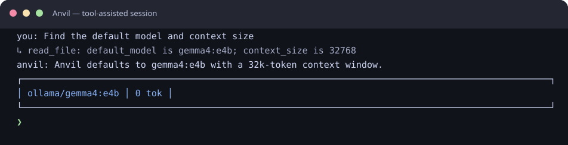
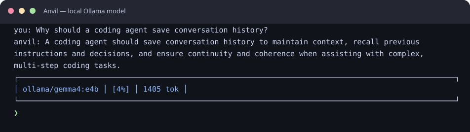

# Anvil

A personal research project exploring agentic AI development workflows. Yet another AI coding harness — built to learn how they work, not to compete with polished tools like [Plandex](https://github.com/plandex-ai/plandex), [aider](https://github.com/paul-gauthier/aider), or [OpenCode](https://github.com/nicepkg/OpenCode).

Chat with local models, run tools, search the web, use skills — all from TypeScript.

> **Disclaimer**: This is a personal experiment shared for like-minded researchers and tinkerers — not a supported product. It is not superior to existing tools, nor does it aim to be. Models can be unreliable, slow, or produce nonsensical output. Use at your own responsibility.

## Anvil in Action

These SVG captures use Anvil's Ink TUI. The first is a deterministic tool-use example; the
second displays an answer generated by Anvil with `gemma4:e4b` through local Ollama.

<p align="center">
  
</p>

<p align="center">
  
</p>

## What Makes Anvil Different

**Local-first.** By default, Anvil connects to Ollama on your machine, so prompts and code stay
local without API keys or usage bills. You can also configure remote providers; when you do, the
data you send is subject to that provider's policies.

**Optimized for smaller models.** Anvil is designed for models that fit on consumer hardware,
including local models in the 7B–35B range. Context management (auto-compaction, overflow
detection, configurable context windows) is a first-class concern.

**What it does:**

- Agentic coding loop with tool use (files, shell, git, web search)
- Automatic context compaction when conversations grow too long
- Overflow detection and recovery — won't silently degrade when context fills up
- Multi-provider support (Ollama native, OpenAI-compatible endpoints, LiteLLM)
- Skills, agents, MCP servers, LSP integration
- Session persistence and history

**What it doesn't do:**

- Compete with Claude Code, Cursor, or Windsurf on frontier model performance
- Provide a graphical UI or editor integration
- Work reliably without a capable model (garbage in, garbage out)
- Handle massive monorepos without tuning context size

## Install Globally

After cloning, build and install as a global binary:

```bash
pnpm install
pnpm build
```

**Option A — symlink (simplest):**

```bash
ln -sf $(pwd)/dist/main.js /usr/local/bin/anvil
```

**Option B — pnpm global link:**

```bash
pnpm link --global .
```

Then run `anvil` from any directory.

To update after code changes: `pnpm build`

## Quick Start

```bash
pnpm install
pnpm dev
```

The default launch is the Ink TUI. Add `-- --simple` to use the readline interface instead.
On first run, creates `~/.anvil/config.yaml` pointing at Ollama on localhost. Default context window is 32k tokens — for large codebases, increase `context_size` in the config (see [Configuration](#ollama-context-size)). Then you're chatting:

Readline example (`pnpm dev -- --simple`):

```
anvil — ollama/gemma4:e4b
Type /quit to exit, /skill to list, /model <name> to switch
Press Esc to cancel the current turn. In the TUI, press Ctrl+C twice quickly while idle to exit.

you: What files are in this directory?
anvil:
  ↳ list_dir done
Here are the files: ...

you: Search the web for vitest coverage setup
anvil:
  ↳ web_search done
Here are the top results: ...
```

## Commands

| Command            | Description                                        |
| ------------------ | -------------------------------------------------- |
| `/help`            | Show available commands                            |
| `/quit`, `/exit`   | Exit                                               |
| `/new`             | Start fresh session                                |
| `/history`         | Browse sessions (TUI picker; CLI list)             |
| `/resume <id>`     | Resume a saved session by ID                       |
| `/usage`           | Show session token usage                           |
| `/context`         | Show context usage, limits, and thresholds         |
| `/compact`         | Manually compact context (summarize history)       |
| `/model <name>`    | Switch model (no arg = picker in TUI, list in CLI) |
| `/model @provider` | List models from another provider                  |
| `/skill <name>`    | Activate a skill (no arg = list all)               |
| `/agent`           | List or switch agents                              |
| `/rewind N`        | Keep the first N user turns                        |
| `/plan <task>`     | Generate a plan and execute it step by step        |
| `/retry`           | Retry the last user request                        |
| `/continue`        | Continue after a round cap or output limit         |
| `/undo`            | Preview the latest file change from this session   |
| `/undo confirm`    | Restore the file change shown in the preview       |
| `/undo cancel`     | Dismiss an undo preview                            |
| `/transcript`      | Export session as Markdown                         |
| `/think`           | Toggle full reasoning text in the TUI              |

Model switches apply to the current session. To change the default, edit `default_provider` and
`default_model` in `~/.anvil/config.yaml`.

## Keyboard Shortcuts

| Key                         | Context                   | Action                    |
| --------------------------- | ------------------------- | ------------------------- |
| `Esc`                       | Agent running or approval | Cancel the current turn   |
| `↑` / `↓`, `Enter`, `Esc`   | Session picker            | Select, resume, or cancel |
| `Ctrl+C`                    | Agent running or approval | Cancel the current turn   |
| `Ctrl+C` twice within 1.5 s | TUI idle                  | Exit                      |
| `Ctrl+C`                    | Readline CLI idle         | Exit                      |
| `Ctrl+C` again within 0.5 s | Readline CLI after cancel | Force exit                |

## CLI Flags

```bash
pnpm dev -- --version               # Show version and exit
pnpm dev -- --simple                # Use readline CLI instead of TUI
pnpm dev -- ~/code/myproject        # Open a specific project directory
pnpm dev -- --model qwen3.6:27b    # Override model
pnpm dev -- --skill code-review     # Start with a skill active
pnpm dev -- --agent explorer        # Use a specific agent config
pnpm dev -- --resume                # Resume latest session for this project
pnpm dev -- --resume abc12345       # Resume a specific session (or unique ID prefix)
pnpm dev -- -c "task description"   # Non-interactive: skip tools requiring approval, then exit
pnpm dev -- -c "task description" --yes  # Non-interactive: approve all tool calls, then exit
pnpm dev -- --debug                 # Show finish_reason in token display
pnpm dev -- ~/code/project -c "run tests"  # One-shot in a specific directory
```

On uncaught process errors and graceful termination signals, Anvil attempts to save the current
session; crash details are written to `~/.anvil/logs/`. A forced kill or power loss cannot be
handled. Pick up where you left off with `--resume`; it prefers the latest session for the current
project and reports when it falls back to another project. Use `--resume <id>` to select a specific
session by ID or unique prefix.

On startup, Anvil warns when the latest session for the current project was interrupted, ended with an error, or contains an unanswered request: `Last session was interrupted — /resume to continue`.

In one-shot `-c` mode, tools that require approval are skipped by default. The tool result is
returned to the model and the skipped call is reported on stderr. Pass `--yes` only when you
intend to let the one-shot run execute approval-gated tools.

## Built-in Tools

| Tool              | Approval    | Description                         |
| ----------------- | ----------- | ----------------------------------- |
| `list_dir`        | conditional | List directory contents             |
| `glob`            | conditional | Find files by pattern               |
| `search`          | conditional | Search file contents                |
| `read_file`       | conditional | Read a file                         |
| `project_context` | auto        | Project overview (deps, git, tree)  |
| `git_status`      | auto        | Git status and branch               |
| `git_diff`        | auto        | Git diff (staged or unstaged)       |
| `git_log`         | auto        | Recent commit history               |
| `web_search`      | auto        | Search the web (DuckDuckGo)         |
| `web_fetch`       | conditional | Fetch URL and extract readable text |
| `write_file`      | y/n         | Write/create a file                 |
| `edit_file`       | y/n         | Whitespace-tolerant edit            |
| `run_cmd`         | y/n         | Run a shell command                 |

Read-only file tools are auto-approved only when the canonical target stays inside the
project. Any path that resolves outside the project—including `~`, absolute paths, parent
traversal, and symlink targets—requires approval; glob results outside the project are omitted.

Before `write_file` or `edit_file` changes a file, Anvil stores its previous contents under
`~/.anvil/file-history/`, grouped by hashed project and file paths. It keeps up to 20 versions
per file and 50 MB of backups per project. At an interactive prompt, use `/undo` to preview the
latest file change in the current session, `/undo confirm` to restore it (or remove a newly created
file), and `/undo cancel` to dismiss the preview.

## Configuration

Global config at `~/.anvil/config.yaml`, created on first run. Change `default_model` to switch models, add providers for remote gateways. See [docs/multi-provider.md](docs/multi-provider.md) for multi-provider setup.

`web_fetch` prompts for approval unless the URL's exact hostname is listed under
`web.allow_domains`. Entries do not include subdomains automatically, and redirects from an
allowlisted host are followed only when each destination host is also listed:

```yaml
web:
  allow_domains:
    - docs.example.com
```

There is no project-local equivalent of `~/.anvil/config.yaml`; project-level prompts, skills,
agents, MCP servers, and LSP settings live in the `.anvil/` files listed below.

### Ollama: Context Size and Model Retention

Anvil uses Ollama's native API (`/api/chat`) which supports runtime context control. The default context is 32k tokens — sufficient for most tasks. To increase it, set `context_size` in `~/.anvil/config.yaml`:

```yaml
context_size: 131072  # 128k — use for large codebases
keep_alive: 30m       # keep native Ollama models loaded between requests
first_token_timeout: 300  # model load and prompt evaluation, in seconds
stream_timeout: 120        # pause allowed between later response chunks
```

`context_size` is sent as `options.num_ctx` in every request. `keep_alive` controls how long
Ollama keeps the model loaded; it defaults to `30m`. The timeout defaults let slow local models
take up to 300 seconds to produce their first response chunk, then 120 seconds between chunks.
No custom Modelfile needed.

> **Note**: If your config has `endpoint: http://localhost:11434/v1` (the `/v1` suffix), Anvil uses the OpenAI-compatible endpoint which does not support context control. Remove the `/v1` to use the native API.

**Alternative: Set context size in Ollama itself.** Instead of relying on Anvil's per-request `num_ctx`, you can bake a larger context into the model:

```dockerfile
# Modelfile
FROM qwen3:8b
PARAMETER num_ctx 65536
```

```bash
ollama create qwen3:8b-64k -f Modelfile
```

Or set the `OLLAMA_NUM_CTX` environment variable to change Ollama's default for all models:

```bash
export OLLAMA_NUM_CTX=65536  # applies to all requests that don't specify num_ctx
```

Anvil calibrates its context estimate from provider-reported token usage, proactively compacts around 80% of the configured context window, and retries after overflow signals at 95% or more. Before output starts, transient connection errors, HTTP 503s, and timeouts are retried with backoff; after streaming starts, partial output is kept and can be retried with `/retry`. Use `/continue` after a round cap or when the provider stops at its output limit. Starting with a context size that matches your workload still avoids unnecessary compaction.

## Per-Project Customization

| Feature        | Location           | Description                                                                               |
| -------------- | ------------------ | ----------------------------------------------------------------------------------------- |
| Project prompt | `.anvil/prompt.md` | Persistent context loaded every session                                                   |
| Skills         | `.anvil/skills/`   | [Agent Skills](https://agentskills.io) standard (also `.kiro/skills/`, `.claude/skills/`) |
| Agent configs  | `.anvil/agents/`   | Trust levels, tool guards, hooks — see [docs/hooks.md](docs/hooks.md)                     |
| MCP servers    | `.anvil/mcp.json`  | External tool servers — see [docs/mcp.md](docs/mcp.md)                                    |
| LSP            | `.anvil/lsp.json`  | Language server integration — see [docs/lsp.md](docs/lsp.md)                              |

## Architecture

```
src/
├── controller/ # Headless session controller and shared command registry
├── provider/   # Ollama native + OpenAI-compatible streaming
├── engine/     # Chat engine — messages, streaming, cancellation, model switching
├── tools/      # Tool registry + built-in tools (files, shell, web)
├── agent/      # Agent loop — state machine with approval gating and round cap
├── agents/     # Agent configs — loader, discovery, guards, hooks
├── lsp/        # LSP client — TypeScript/Python diagnostics, navigation, auto-inject
├── mcp/        # MCP client — connect to external tool servers (stdio + HTTP)
├── config/     # YAML config loader with validation and defaults
├── session/    # Session persistence (auto-save, resume, history)
├── skills/     # Skill parser + multi-directory discovery
├── web/        # Web search (DuckDuckGo) + fetch (Readability extraction)
├── tui/        # Importable Ink view and TUI entry point
├── cli/        # Readline frontend and queued input helper
├── shared/     # Shared application bootstrap
├── cli.ts      # Readline entry shim
└── main.ts     # Routes to TUI or CLI based on flags/environment
```

The controller owns turns, approval queues, and session persistence. Both UIs submit input and
render controller state/events; their keyboard handling and presentation remain frontend-specific.
See [docs/architecture.md](docs/architecture.md) for design details.

## Development

```bash
pnpm install
pnpm dev               # Launch interactive CLI (TUI default)
pnpm build             # Bundle to dist/
pnpm test              # Run unit tests
pnpm test:integration  # Run CLI integration tests against mock providers
pnpm test:coverage     # Unit tests with a v8 coverage report
pnpm check             # Type-check
pnpm lint              # Biome + oxlint
pnpm format            # Biome (code) + dprint (markdown)
```

## Requirements

- Node.js 22+
- pnpm
- Ollama for the default local setup; other OpenAI-compatible providers can be configured

## Documentation

| Doc                                         | Content                                                  |
| ------------------------------------------- | -------------------------------------------------------- |
| [architecture.md](docs/architecture.md)     | Shared controller, provider layer, agent loop, tools     |
| [multi-provider.md](docs/multi-provider.md) | LiteLLM, OpenRouter, remote provider setup               |
| [models.md](docs/models.md)                 | Model benchmarks, recommendations, hardware setup guides |
| [hooks.md](docs/hooks.md)                   | Agent lifecycle hooks and guardrails                     |
| [mcp.md](docs/mcp.md)                       | MCP server configuration (stdio + HTTP)                  |
| [lsp.md](docs/lsp.md)                       | Language server integration and tools                    |
| [ideas.md](docs/ideas.md)                   | Future development ideas                                 |
