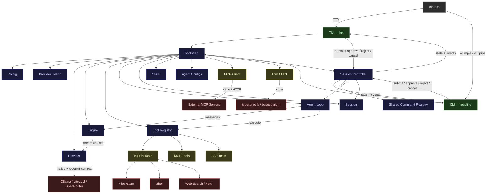
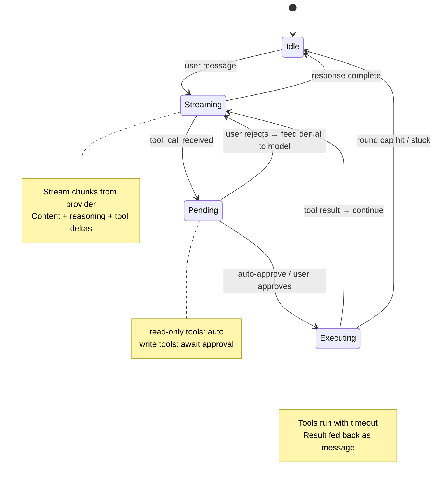
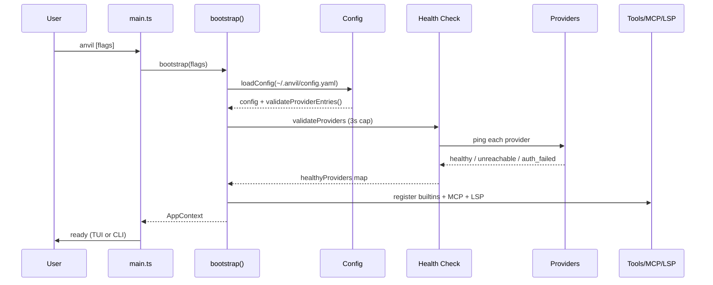

# Architecture

## System Overview



## Agent Loop State Machine



## Boot Sequence



## Module Layout

```
src/
├── main.ts                  Routes to TUI or readline CLI
├── controller/              Headless session controller + shared commands
├── shared/bootstrap.ts      Startup orchestration and AppContext
├── config/                  YAML loader, validation, env var interpolation
├── provider/                Ollama native + OpenAI-compatible streaming
├── engine/                  Message history, streaming, model switching
├── agent/                   State machine — send/approve/reject/cancel
├── agents/                  Agent YAML configs — guards, hooks, trust levels
├── tools/                   Registry + built-in tools (fs, shell, git, web)
├── mcp/                     External tool servers (stdio + HTTP transport)
├── lsp/                     Language servers — diagnostics, navigation, rename
├── session/                 Auto-save, resume, history browser
├── skills/                  Skill discovery + parser (multi-directory)
├── web/                     DuckDuckGo search + Readability fetch
├── tui/app.tsx               Importable Ink view
├── tui/entry.tsx             TUI bootstrap and renderer
├── cli/readline.ts           Readline frontend
└── cli/readline-input.ts     Queued readline and approval input
```

## Provider Layer

Two provider implementations, same `Provider` interface:

- **Ollama native** (`/api/chat`) — auto-detected when endpoint has no `/v1` suffix. NDJSON streaming, `options.num_ctx` for runtime context control, native tool call format.
- **OpenAI-compatible** (`/v1/chat/completions`) — for LM Studio, llama.cpp, LiteLLM, OpenRouter, or Ollama with `/v1` suffix. SSE streaming, standard tool call deltas.

```typescript
type StreamChunk = {
  content?: string
  reasoning?: string
  toolCall?: ToolCallDelta
  done: boolean
  usage?: { promptTokens: number; totalTokens: number }
}
```

Robustness:

- Stream timeout — abort if no chunk arrives within configured seconds
- Connection timeout — accounts for model cold-loading
- Partial tool call recovery — lenient JSON parsing for incomplete output
- Empty response detection — retry once before reporting failure
- Graceful degradation — never hang, every await has a timeout

## Shared Session Controller

Both interactive frontends use the headless controller in `src/controller/`. It is the only
owner of turn execution: UIs submit chat text or commands and send approval, rejection, and
cancellation decisions; they do not call the agent loop directly.

The controller publishes immutable state snapshots and agent events for streaming text, phase
changes, pending tool approvals, usage, and notices. The Ink view subscribes with
`useSyncExternalStore`; the readline frontend renders those events to the terminal. Shared
commands use the same registry in both frontends, while input handling and rendering stay
presentation-specific.

The controller also coordinates approval queues, saves the session after committed work, waits
for cancellation to settle, and performs bounded shutdown. The readline frontend separately
queues lines typed during a turn and keeps approval prompts fresh-only; the TUI keeps its input
visible while the controller is busy.

## Agent Loop

Sequential state machine for tool-using interactions:

```
idle → streaming → pending → executing → streaming → ...
                          ↘ done/stuck → idle
```

- **Round cap**: Maximum iterations per turn (default 25)
- **Approval gating**: Side-effecting tools require user confirmation
- **Read-only tools auto-execute**: `list_dir`, `glob`, `search`, `read_file`
- **Retry on malformed tool calls**: Send error back to model, let it retry
- **Context management**: Calibrate the chars/4 estimate from provider usage, pre-trim at 80%, compact after usage reaches 80%, and treat 95% as overflow with one retry per turn

## Tool Registry

Tools are registered with a schema, approval requirement, timeout, and execute function. Built-in tools cover file operations, shell, git, and web. MCP tools are merged into the same registry at runtime.

```typescript
type Tool = {
  name: string
  description: string
  schema: JsonSchema
  needsApproval: boolean
  timeout: number
  execute: (args: Record<string, unknown>, context: ToolExecutionContext) => Promise<string>
}

type ToolExecutionContext = {
  signal: AbortSignal
  projectRoot: string
}
```

The agent races tool execution against its timeout and turn-cancellation signal. Tools that
support interruption should observe `context.signal`; cancellation is returned to the model as
`"[cancelled by user]"`.

## Agent Configs

YAML definitions in `.anvil/agents/` control tool access, auto-approval, path guards, command regex filters, and lifecycle hooks per agent profile.

## Error Handling

All fallible operations return `Result<T, E>` or `ResultAsync<T, E>` (neverthrow). No thrown exceptions in business logic. Errors are typed discriminated unions.

## Configuration

YAML config at `~/.anvil/config.yaml` — provider endpoints, default model, timeouts, context size, and display preferences. Created automatically on first run.
